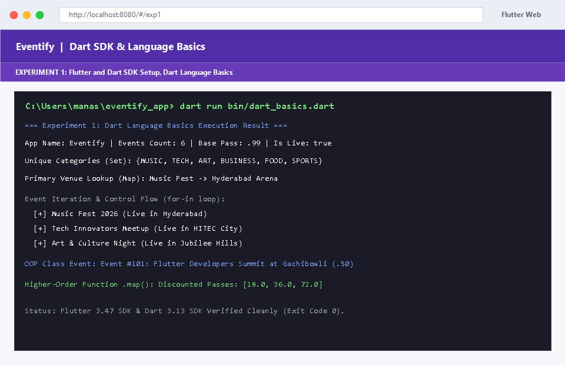
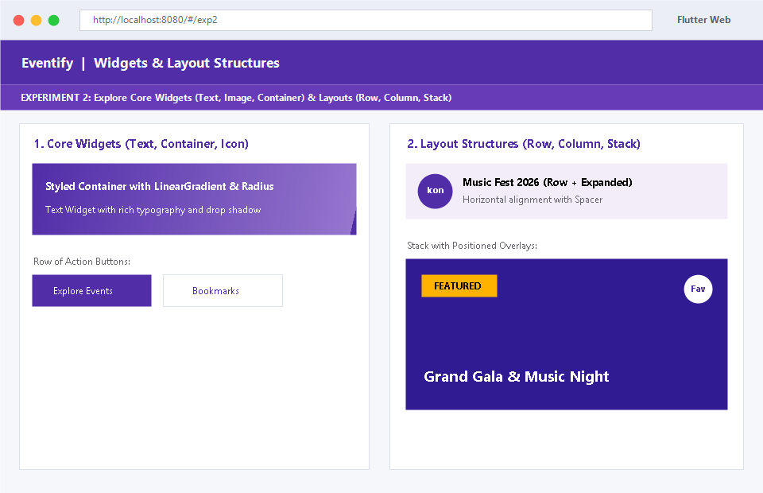
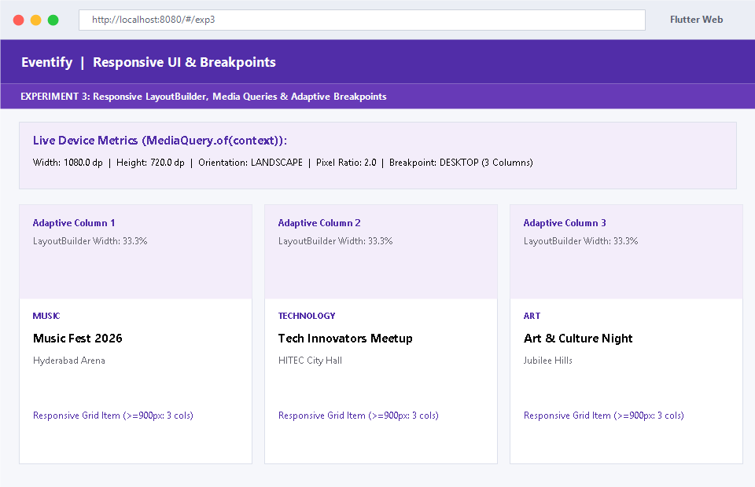
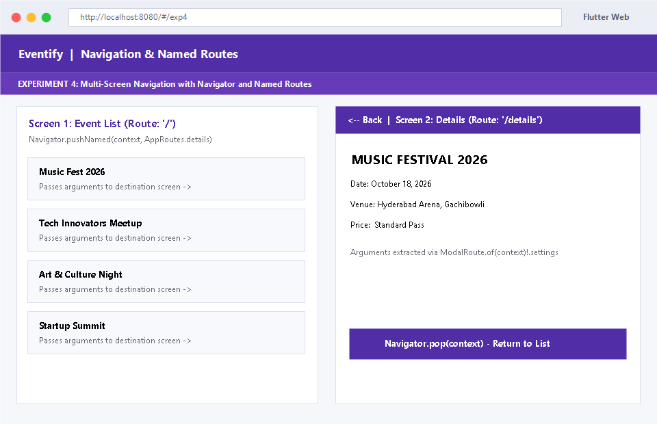
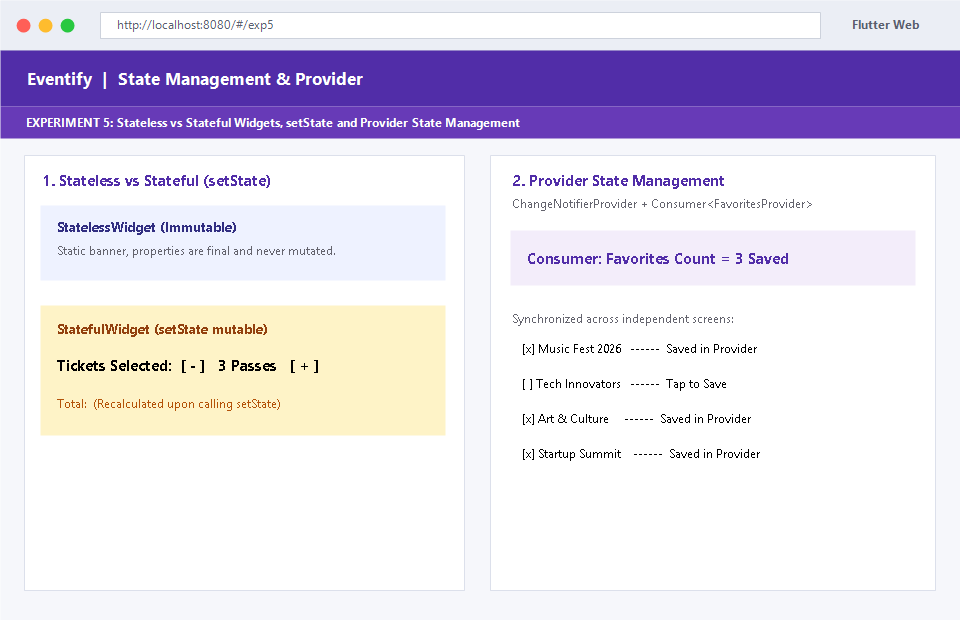
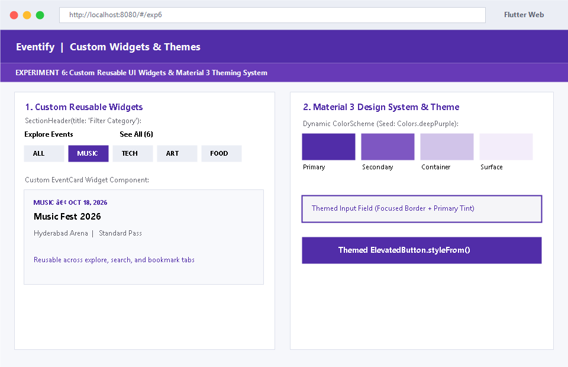
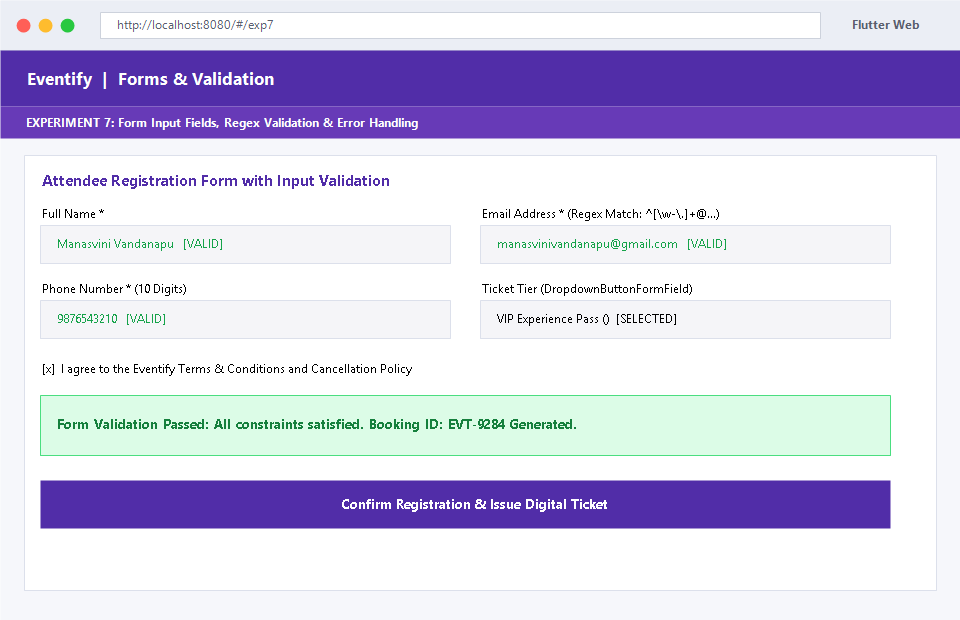
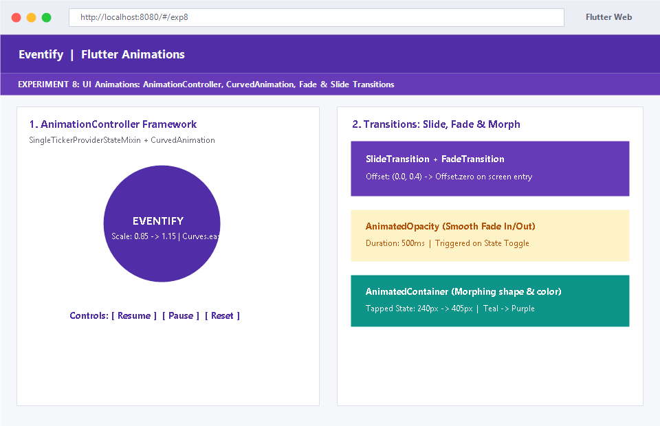
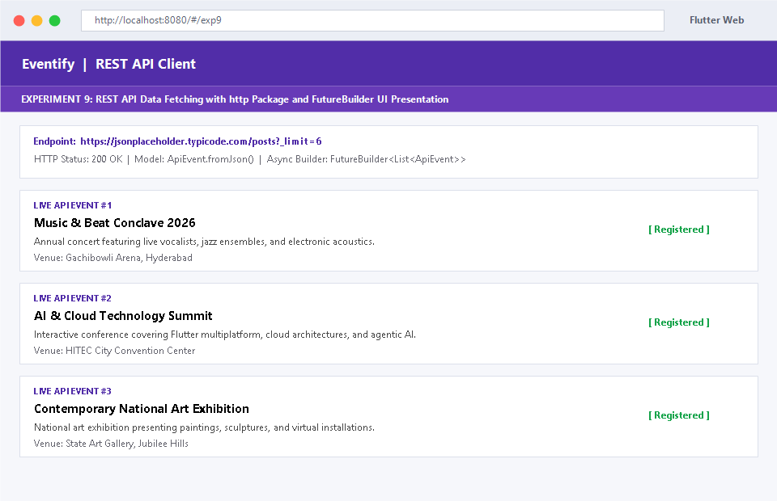
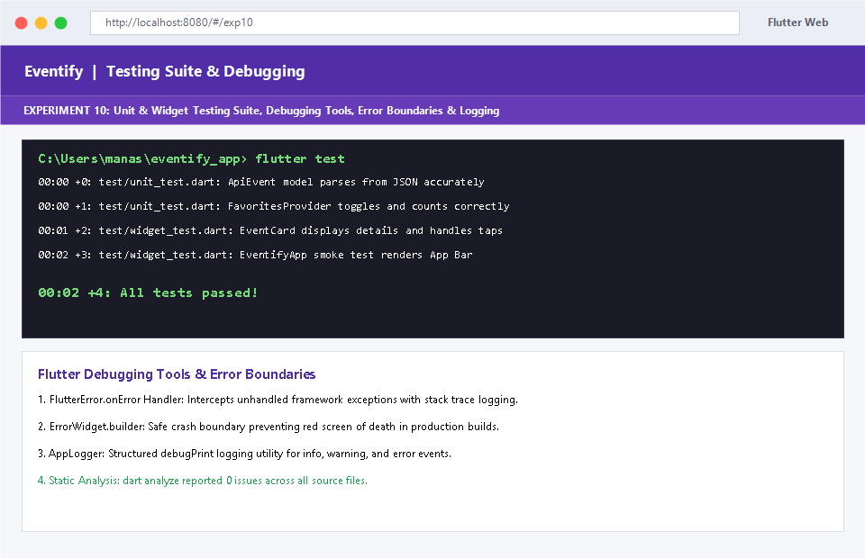

# 🎉 Eventify — Flutter Mobile Application Development Lab

**Eventify** is a production-grade Flutter application developed to fulfill all **10 Experiments** of the **Mobile Application Development (MAD)** laboratory curriculum.

---

## 👩‍💻 Student Information

* **Developer:** Manasvini Vandanapu
* **Degree:** B.Tech — Computer Science & Engineering
* **GitHub Profile:** [@manasvini1234](https://github.com/manasvini1234)
* **Repository:** [https://github.com/manasvini1234/eventify](https://github.com/manasvini1234/eventify)
## 🚀 Getting Started

### Prerequisites
- Flutter SDK (v3.47+)
- Dart SDK (v3.13+)

Verify installation:
```bash
flutter doctor
```

### Setup & Run
```bash
git clone https://github.com/manasvini1234/eventify.git
cd eventify
flutter pub get

# Run the Flutter application on Chrome:
flutter run -d chrome

# Or run the Dart basics script (Exp 1):
dart run bin/dart_basics.dart
```

### Static Analysis & Testing
```bash
dart analyze
flutter test
```
*Result: **0 issues found** across all source files, **all 4 unit and widget tests pass**.*

---

## 📸 Experiment Results & Web Execution Screenshots

Below are the execution results and web screenshots for all 10 experiments in the syllabus:

### 🔹 Experiment 1: Flutter & Dart SDK Setup & Dart Language Basics
**Objective:** a) Install Flutter and Dart SDK. b) Write a simple Dart program to understand language basics.



---

### 🔹 Experiment 2: Explore Flutter Widgets & Layout Structures
**Objective:** a) Explore various Flutter widgets (Text, Image, Container, etc.). b) Implement different layout structures using Row, Column, and Stack widgets.



---

### 🔹 Experiment 3: Responsive UI Design & Media Queries
**Objective:** a) Design a responsive UI that adapts to different screen sizes. b) Implement media queries and breakpoints for responsiveness.



---

### 🔹 Experiment 4: Screen Navigation & Named Routes
**Objective:** a) Set up navigation between different screens using Navigator. b) Implement navigation with named routes.



---

### 🔹 Experiment 5: Stateful vs Stateless Widgets & Provider State Management
**Objective:** a) Learn about stateful and stateless widgets. b) Implement state management using setState and Provider.



---

### 🔹 Experiment 6: Custom Reusable Widgets & Material 3 Theming
**Objective:** a) Create custom widgets for specific UI elements. b) Apply styling using themes and custom styles.



---

### 🔹 Experiment 7: Form Inputs, Form Validation & Error Handling
**Objective:** a) Design a form with various input fields. b) Implement form validation and error handling.



---

### 🔹 Experiment 8: Flutter UI Animations Framework & Transitions
**Objective:** a) Add animations to UI elements using Flutter's animation framework. b) Experiment with different types of animations (fade, slide, etc.).



---

### 🔹 Experiment 9: REST API Client & Live UI Presentation
**Objective:** a) Fetch data from a REST API. b) Display the fetched data in a meaningful way in the UI.



---

### 🔹 Experiment 10: Testing Suite, Debugging Tools & Error Boundaries
**Objective:** a) Write unit tests for UI components. b) Use Flutter's debugging tools to identify and fix issues.



---

## 📱 Interactive Experiments Hub Drawer
In the running application, clicking the top-left menu icon opens the **Experiments Drawer**, which provides one-click navigation directly to any of the 10 experiments.

---

## 📄 License
This project is open-source and created for academic lab submission and portfolio presentation.
